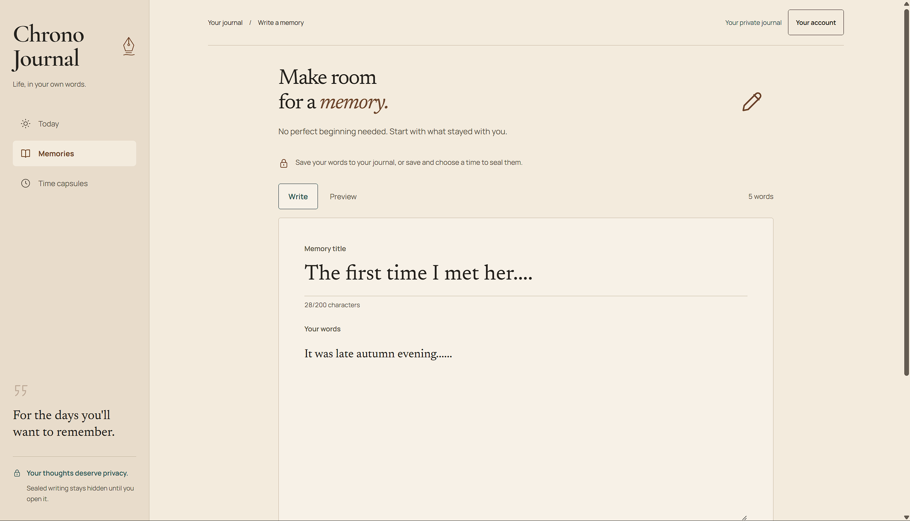
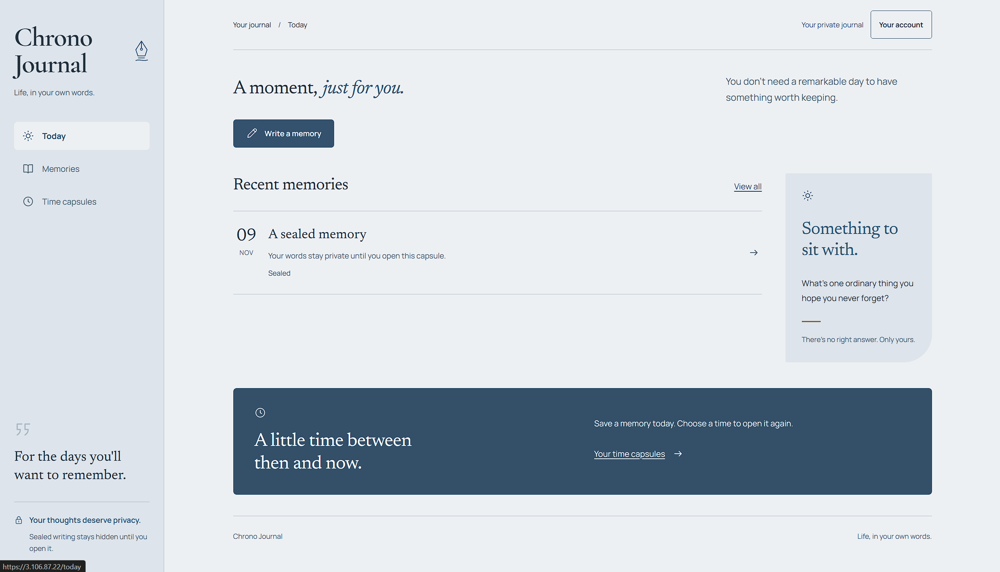

# Chrono Journal

A personal journal for saving everyday memories, photos and recordings. Write something now, or seal it in a time capsule to open later. The current release focuses on personal accounts; shared journals will come later.

## Problems

- **Limited attachment formats:** Some file types are unsupported, and playback depends on the browser. Accepted formats are listed below.
- **No shared editing yet:** Couple journals, partner invitations and editing together are not part of this release.
- **No offline draft recovery:** Save before refreshing or closing the browser. Unsaved writing is not stored permanently.
- **Lost vault keys cannot be recovered:** Your account password cannot replace the separate key used to unlock your journal.
- **Large videos take time to load:** The browser downloads and decrypts the whole file before playback.
- **Some details remain visible:** Content is encrypted, but account details, timestamps, capsule status and file sizes are still stored as normal metadata.

## Features

- **Write and edit memories:** Save a title, some writing, or both. Preview before saving and edit an unsealed memory later.
- **Browse and search:** Find saved memories and search unlocked content on your device. Sealed writing stays out of search results. Search currently checks up to 2,000 memories.
- **Time capsules:** Pick a future date, review the memory and seal it. Its title, writing and attachments stay hidden in the app until it is ready and you choose to open it. Sealed capsules cannot be edited or rescheduled.
- **Media attachments:** Add up to ten files to a saved memory. Pictures support JPEG, PNG and WebP up to 10 MiB; audio supports MP3, WAV, OGG, M4A and WebM up to 25 MiB; video supports MP4 and WebM up to 100 MiB.
- **Voice notes:** Record with your browser microphone, preview the recording and attach it to a memory. Recordings are limited to five minutes and use the audio size limit.
- **Encrypted content:** Writing, files, filenames and private attachment details are encrypted on your device before upload. Sign in, then unlock your journal with your saved vault key.
- **Appearance settings:** Choose Parchment, Botanical or Slate, switch between light, dark and system mode, and optionally use the pen-style pointer. Choices are remembered in the current browser.

## Tech Stack

- **Frontend:** React and Vite.
- **Backend:** Go.
- **Database:** PostgreSQL.
- **Storage:** Local files for development, with Cloudflare R2 support for cloud storage.
- **Local setup:** Docker and Docker Compose.
- **Privacy:** Browser-side encryption with a separate vault key.

## How to run locally

These steps use **Windows PowerShell** and the complete Docker setup. Docker builds the frontend and backend and runs PostgreSQL, so separate Go, Node.js and PostgreSQL installations are unnecessary for this route.

1. **Install Git and Docker Desktop.** Start Docker Desktop using Linux containers and wait for it to finish starting.

2. **Clone the project and enter its folder.** If you already have it, open that folder instead.

   ```powershell
   git clone https://github.com/AryaaaSahu01/project.git
   Set-Location .\project
   ```

   Your checkout must contain `Dockerfile` and `deploy/compose.release-test.yml`. If they are missing, apply the encrypted release package first.

3. **Build the application.** Run from the project root. Stop if the build fails.

   ```powershell
   docker compose -f deploy/compose.release-test.yml build --pull
   if ($LASTEXITCODE -ne 0) { throw 'Build failed.' }
   ```

4. **Start the app, database and worker.** Keep Docker Desktop running while using the application.

   ```powershell
   docker compose -f deploy/compose.release-test.yml --profile worker up -d --wait app worker
   if ($LASTEXITCODE -ne 0) { throw 'Startup failed.' }
   ```

5. **Open [http://localhost:8081](http://localhost:8081).** Create an account, generate a vault key and save it outside the app before confirming it. You need that key again after refreshing or switching devices.

6. **Try the main flow.** Save a memory, add an attachment, refresh to check that it remains saved, then seal a test capsule for a time at least one minute ahead. When it becomes ready, open it from the capsule list.

7. **Check status or stop the application.** Run these from the same project folder. Stopping keeps the database and uploaded files in Docker volumes.

   ```powershell
   docker compose -f deploy/compose.release-test.yml ps
   docker compose -f deploy/compose.release-test.yml --profile worker down
   ```

This stack uses separate local data; it does not import an existing journal. For existing records, follow [Encrypted Installation](docs/ENCRYPTED-INSTALL.md). For direct Go/React development or more setup help, see [Local Setup](docs/LOCAL_SETUP.md).

## Coming Soon

- Couple journals and partner invitations.
- Shared encryption keys for partner access.
- Editing together, including handling simultaneous changes.
- Further personal-journal improvements tracked in the [post-launch checklist](docs/POST-LAUNCH-CHECKLIST.md).

## AI Usage

- Frontend layout, font and colour inspiration.
- Suggestions for organising the Go backend.
- Help with an initial database schema.
- Help reviewing and fixing small bugs and typos.

NOTE: For further AI usage details, please review AI_USAGE md file.

[AI Usage Log](AI_USAGE.md)

## Screenshots


### Writing a memory


### Browsing memories


### Photos and recordings


### Time capsules


### Sealed View


### All Memories

