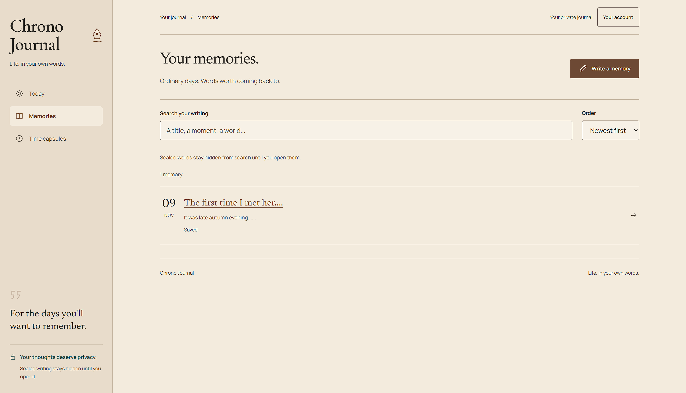
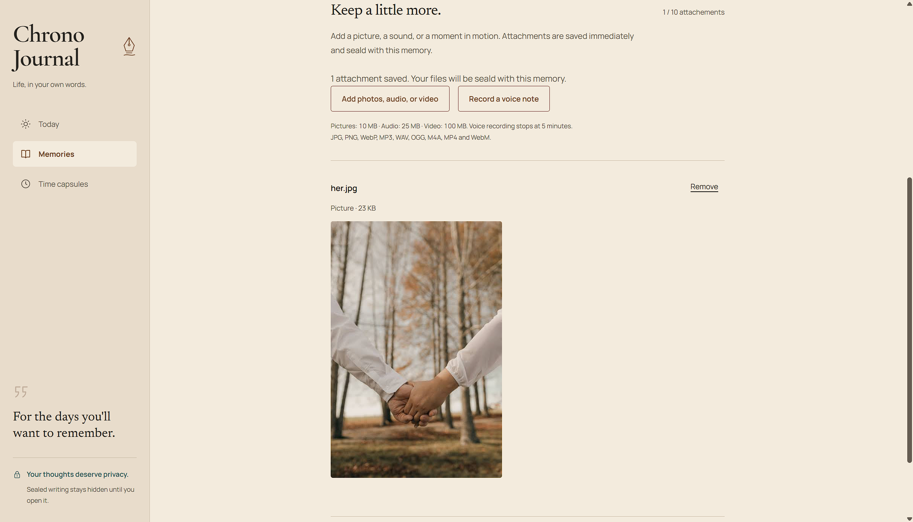
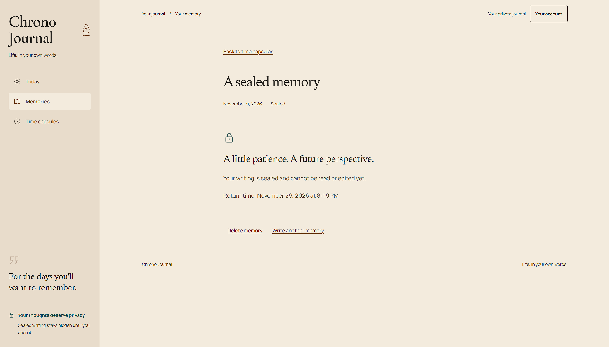
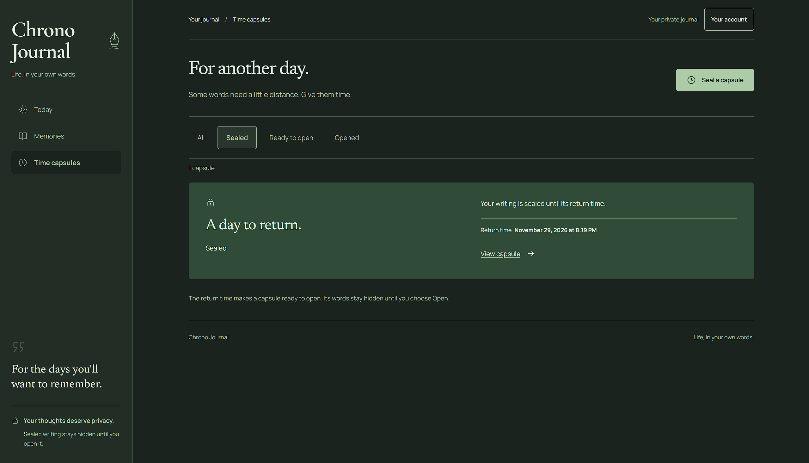

# Chrono Journal

See how your memories come back to you!
The current release focuses on YOU; shared journals will come later.

## Problems

- **Limited attachment formats:** Some file types are unsupported, and playback depends on the browser. Accepted formats are listed below in media attachments of features section.
- **No shared editing yet:** Not exactly a problem but I believe it's worth mentioning because I want it to be a shared journal for friends, couples & hopefully families to use.
- **No offline draft recovery:** Save before refreshing or closing the browser. Unsaved writing will be doom(sday).
- **Lost vault keys cannot be recovered:** Your account password cannot replace the separate key used to unlock your journal.
- **Large videos take time to load:** The browser downloads and decrypts the whole file before playback.
- **Some details remain visible:** The content is encrypted and that's all you need to care about.

## Features

- **Write and edit memories:** Obvious one.
- **Browse and search:** Find saved memories and search unlocked content on your device. Sealed writing stays out of search results. Search currently checks up to 2,000 memories.
- **Time capsules:** Pick a future date, review the memory and seal it. Its title, writing and attachments stay hidden in the app until it is ready and you choose to open it. 

**NOTE:** Sealed capsules cannot be edited or rescheduled.
- **Media attachments:** Add up to ten files to a saved memory. Support file types: JPEG, PNG and WebP up to ~10 MB, MP3, WAV, OGG, M4A up to ~25 MB, MP4 and WebM up to ~100 MB.
- **Voice notes:** Record with your browser microphone, preview the recording and attach it to a memory. Recordings are limited to five minutes and use the audio size limit (~25MB).
- **Encrypted content:** Writing, files, filenames and private attachment details are encrypted on your device before upload. Vault key is needed upon signing in to access it.
- **Appearance settings:** Parchment, Botanical and Slate themes are available, all with a light/dark toggle. There's also a pen-style pointer which you can disable ( please don't :-) ). The theme you choose will come back to you if it's in the same browser.

## Tech Stack

- **Frontend:** React and Vite.
- **Backend:** Go.
- **Database:** PostgreSQL.
- **Storage:** Local files for development, with Cloudflare R2 support for cloud storage.
- **Local setup:** Docker and Docker Compose.
- **Privacy:** Browser-side encryption with a separate vault key.

## How to run locally

1. Install Git and Docker Desktop. Start Docker Desktop using Linux containers.

2. Clone the project and enter its folder. If you already have it, open that folder instead.

   Your checkout must contain `Dockerfile` and `deploy/compose.release-test.yml`.

3. **Build the application.** Run from the project root. Stop if the build fails.

   docker compose -f deploy/compose.release-test.yml build --pull
   if ($LASTEXITCODE -ne 0) { throw 'Build failed.' }

4. **Start the app, database and worker.** Keep Docker Desktop running while using the application.

   docker compose -f deploy/compose.release-test.yml --profile worker up -d --wait app worker
   if ($LASTEXITCODE -ne 0) { throw 'Startup failed.' }

5. **Open [http://localhost:8081](http://localhost:8081)** & pour your heart out!

## Coming Soon

- Couple journals and so obvioiusly partner invitations.
- Shared encryption keys for partner access.
- Editing together, including handling simultaneous changes.
- Further personal-journal improvements.

## AI Usage

- Frontend layout, font and colour inspiration.
- Suggestions for organising the Go backend.
- Help with an initial database schema.
- Help reviewing and fixing small bugs and typos.

NOTE: For complete AI usage details, please review AI_USAGE.md file.

[AI Usage Log](AI_USAGE.md)

## Screenshots

### Writing a memory

### Browsing memories

### Photos and recordings

### Time capsules

### Sealed View

### All Memories

